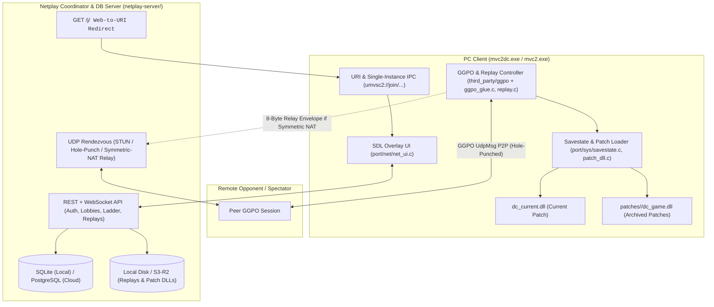
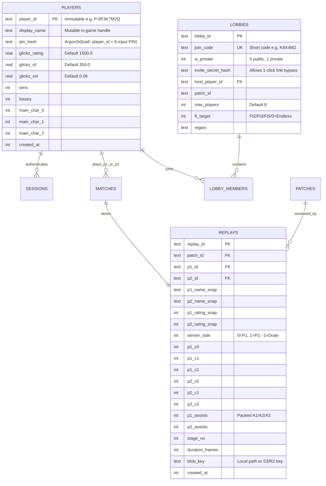

# UMvSC2 Netplay, Rollback, Replays & Online Services Plan

## Goal Description

Design and implement a complete, tournament-grade online and replay ecosystem for **Ultimate Marvel vs. Super Capcom 2** on the PC port (`mvc2-naomi-dc/ports`), targeting **Dreamcast mode (`dc` / `mvc2dc.exe`) primarily**:

1. **Minimized Headless Test Runner**: Ensure `MVC2_FRAMES` / `MVC2_HEADLESS` runs start minimized without activation (`SW_SHOWMINNOACTIVE`) so automated determinism, rollback, and replay tests never steal window focus.
2. **Deterministic Savestates & GGPO Rollback Engine**: Sub-millisecond frame snapshots paired with **vendored official `pond3r/ggpo`** (`MAX_PREDICTION_FRAMES = 8`), enhanced with custom NAT hole-punched/relayed UDP transport, smooth micro-rift frame pacing, `ggpo_start_spectating` support, glitch-free AICA/ADX rollback audio, and Training Mode standby.
3. **Replays, Patch Retrocompatibility & Replay Takeover**: Compact `.mvc2r` input-stream replays (~2–4 KB per match), **per-patch versioned game-logic DLLs (`dc_<patch_id>.dll`)** so historical replays play back and support **Replay Takeover** (P1 or P2 live control from any scrubbed frame/bookmark) with 100% exact historical physics and zero `#ifdef` clutter in gameplay code.
4. **Stationary Player Identity + 6-Input Arcade Password**: Immutable server-issued `player_id` paired with a stick/pad-friendly 6-input password (`{U, D, L, R, LP, HP, A1, LK, HK, A2}`), allowing players to change their in-game display name freely while keeping leaderboard rank, match history, and cross-PC login intact.
5. **Lobbies, Private Lobbies, Clickable Join Links, Replay Database & Ladder**: Self-contained, cloud-ready coordination & storage service (local SQLite + filesystem out of the box; PostgreSQL + S3/R2 env-configurable for cloud hosting) powering Public Lobbies (King-of-the-Hill rotation + spectators), Private Lobbies (room codes + 1-click links), `https://<host>/j/<code>` -> `umvsc2://join/...` instant join links, Glicko-2 Ranked Ladder, and searchable Replay Database (filterable by characters, assists, winner, player, rating, and patch).

---

## User Review Required

> [!IMPORTANT]
> **Phased Delivery Strategy (6 Milestones)**
> Because this spans deterministic engine internals, P2P networking, binary plugin isolation, a cloud-ready backend, and an in-game overlay UI, execution is structured into **6 sequential, independently verifiable milestones**:
> - **Phase 1**: Minimized headless runner + x86 coroutine stack serialization + Dreamcast deterministic savestates & headless desync harness.
> - **Phase 2**: Versioned `dc_<patch_id>.dll` loader + `.mvc2r` Replay recorder/player + Timeline scrubbing & **Replay Takeover**.
> - **Phase 3**: Vendored **`pond3r/ggpo`** rollback integration (`p2p`, `synctest`, `spectate`) + NAT hole-punching / UDP relay + Direct Challenge & **Clickable Join Links** (`umvsc2://` + single-instance IPC handoff).
> - **Phase 4**: Go backend server (Auth with Stationary ID + 6-input password, Public & Private Lobbies, Glicko-2 Ladder, Replay DB & Match Search, Cloud Docker packaging).
> - **Phase 5**: Native SDL Netplay Overlay UI (Profile/6-Input PIN pad, Lobby Browser & Cabinet Room, Ranked Queue in Training Mode Standby, Leaderboard, Replay Search Browser).
> - **Phase 6**: End-to-end multi-instance stress tests (simulated latency/jitter/packet loss, cross-patch replay takeover, `build-dist` sync).

Each phase will be executed **sequentially (Phase 1 → Phase 6)** upon approval, committed in small, single-responsibility checkpoints, and verified before advancing to the next milestone.

> [!NOTE]
> **Client, Rollback & Backend Stack (`C` + `GGPO` + `Go`)**
> All game, port, savestate, replay, and SDL UI modules inside `mvc2dc.exe` / `mvc2.exe` remain **pure C**, calling **MIT-licensed `pond3r/ggpo`** through its pure C header (`ggponet.h`, compiled as a static C++ target `mvc2_ggpo` with `-static-libstdc++ -static-libgcc` so zero extra C++ runtime DLLs are needed in `build-dist/`). The coordination & storage server (`netplay-server/`) is written in **Go** (`net/http`, raw `net.UDPConn` 60 Hz hole-punch/relay, `database/sql` with CGo-free `modernc.org/sqlite` locally and `jackc/pgx/v5` PostgreSQL in the cloud, `golang.org/x/crypto/argon2` + `crypto/ed25519`), compiling to a single static binary (`FROM scratch` Docker image) ready for low-latency cloud hosting.

To guarantee zero desyncs across different player setups on Dreamcast mode, match sessions enforce strict deterministic state boundaries:

> [!WARNING]
> **Dreamcast Match Canonicalization Rules**
> Local Dreamcast saves (`vmu_save_A1.bin`) and local `OPTION` settings (`com_time`, button macros, damage level) differ across players' machines and would cause immediate desyncs if read during netplay or replays. Whenever entering a **Netplay** or **Replay** session, the host layer will temporarily detach the local VMU (`present = 0`), force `host_unlock = 1` (all 56 fighters, colors, and stages unlocked), apply the lobby/replay's canonical `NET_WORK` / `OPTION_WORK` rules, set `Sys->pause_off = 1`, and seed `rnd_init()` + `nlRandomSeed()` + `host_clock()` from the match's negotiated `match_seed`. Local offline Arcade/Training/VMU saves remain untouched.

---

## Architecture Overview



---

## Proposed Changes

### Component 1: Minimized Headless Runner & Deterministic Savestate Core (`ports/port/sdl`, `ports/port/sys`, `ports/port/dc`)

#### [MODIFY] [main_sdl.c](file:///j:/Users/Dudu/Documents/Programas/XMvSF2/mvc2-naomi-dc/ports/port/sdl/main_sdl.c)
- **Minimized, No-Activate Headless Window**:
  - When `test_run` (`MVC2_FRAMES`) or `MVC2_HEADLESS=1` is set, set `SDL_HINT_WINDOW_ACTIVATE_WHEN_SHOWN="0"` and `SDL_HINT_WINDOW_ACTIVATE_WHEN_RAISED="0"` prior to `SDL_CreateWindow`, create the window with `SDL_WINDOW_MINIMIZED` (or `SDL_WINDOW_HIDDEN` when using software renderer without window presentation), and on Win32 enforce `ShowWindow(hwnd, SW_SHOWMINNOACTIVE)` so headless tests never steal foreground focus.
- **Session Input Hook & Multi-Input Test Injection**:
  - Route `host_input()` through `net_session_input(&raw_input)` so local play passes straight through, Netplay substitutes synchronized `(local, remote)` inputs per player slot, Replay Playback feeds recorded `(p1, p2)` inputs, and **Replay Takeover** feeds live controller input to the taken-over side while keeping recorded inputs on the other side.
  - Extend `MVC2_PRESS` to optionally accept `p2:` inputs (e.g. `120:p2:b1`) for automated 2-player determinism tests.

#### [NEW] [coro_x86.c](file:///j:/Users/Dudu/Documents/Programas/XMvSF2/mvc2-naomi-dc/ports/port/sys/coro_x86.c)
- Replace `coro_win32.c`'s opaque OS fiber (`CreateFiber`/`SwitchToFiber`, whose internal stack/TEB cannot be cleanly `memcpy`-snapshotted) with a ~45-line 32-bit x86 stack-switching coroutine matching the design of [coro_arm.c](file:///j:/Users/Dudu/Documents/Programas/XMvSF2/mvc2-naomi-dc/ports/port/sys/coro_arm.c):
  - Allocates a known `c->stack` buffer (`GAME_STACK`), saves callee-saved registers (`ebx`, `esi`, `edi`, `ebp`), x87 CW + SSE `mxcsr`, and `esp` into `c->sp`.
  - Exposes `coro_state_size(const coro*)`, `coro_state_save(const coro*, void*)`, and `coro_state_load(coro*, const void*)` copying only `(stack_top - c->sp)` active bytes (~128 bytes at `nlWaitVSync()`!).

#### [MODIFY] [select.c](file:///j:/Users/Dudu/Documents/Programas/XMvSF2/mvc2-naomi-dc/src/select.c)
- Move `sel_char_cache[64]` pointer table out of `dc_program.span` `.bss` into a host-managed helper (`host_preview_cache_get/set`) so rolling back across a character highlight on Character Select never overwrites cached heap pointers with `NULL` or leaks `0x160000`-byte preview buffers.

#### [NEW] [savestate.h](file:///j:/Users/Dudu/Documents/Programas/XMvSF2/mvc2-naomi-dc/ports/port/include/savestate.h)
#### [NEW] [savestate.c](file:///j:/Users/Dudu/Documents/Programas/XMvSF2/mvc2-naomi-dc/ports/port/sys/savestate.c)
- Implements fast, deterministic snapshot/restore + `uint64_t` XXH3/FNV-1a state hashing (`savestate_checksum()`) across all mutable Dreamcast subsystems:
  1. **Active `HOST_PROGRAM` span** (`dc_program.span.data` + `dc_program.span.bss`).
  2. **Dreamcast mutable low RAM**: `0x0C010000..0x0C010080`, `0x0C132790..0x0C1742C0`, and `0x0C1C3F24..0x0C3539B0` (~1.81 MB total, skipping the immutable 1.45 MB SH4 code ranges), plus `syMalloc` arena (`0x0CE2A020..0x0CE2E820`, 18 KB).
  3. **High RAM (`0x0C420000..0x0CF00000`) dirty-page / scene-load tracker**: During active fights (`Sys->scene_no == 2 && Sys->routine_0 == 3 && Sys->routine_1 == 2`), character/stage buffers are read-only (0 bytes copied!). During Character Select / loading transitions, dirty 64 KB blocks + open `GDFS` handle table `(file_idx, pos, stat)` in [dc_gd.c](file:///j:/Users/Dudu/Documents/Programas/XMvSF2/mvc2-naomi-dc/ports/port/dc/dc_gd.c) are snapshotted incrementally.
  4. **Board, Shinobi & Render state**: `frames`, `polls_frame`, `frame_polls`, `imask`, `render_done`, `pads[4]`, `tmr_base`, `NLSystemWork_`, `nl_scr`, `rd_palette[1024]` (4 KB), `rd_fog` (520 B), `nl_fade_r/g/b`, and `game_coro` active stack.
  5. **Glitch-Free Rollback Audio state**: Leverages existing `aica_state_save/load()` in [aica.c](file:///j:/Users/Dudu/Documents/Programas/XMvSF2/mvc2-naomi-dc/ports/port/snd/aica.c#L455-L470) (~38 KB) + `arm7_get_regs/set_regs()` + AICA driver work RAM `aica_ram[0..0x10000]` (64 KB, matching `CHECK_RAM` in [snd_drv.c](file:///j:/Users/Dudu/Documents/Programas/XMvSF2/mvc2-naomi-dc/ports/port/snd/snd_drv.c#L379)) + `snd_nl` slot/stream/ring state + `dc_adx` `player` state (~105 KB total), paired with a 64-sample (~1.4 ms) crossfade in [sdl_audio.c](file:///j:/Users/Dudu/Documents/Programas/XMvSF2/mvc2-naomi-dc/ports/port/sdl/sdl_audio.c) after any rollback.
  6. **Debug `MEM_WRITE_WATCH` verifier**: Optional test mode using Win32 `GetWriteWatch` on `0x0C000000..0x0E000000` to assert in CI/tests that zero mutated pages ever fall outside `savestate_save()`.

```c
typedef struct SAVESTATE SAVESTATE;

SAVESTATE* savestate_alloc(void);
void       savestate_free(SAVESTATE* st);
void       savestate_save(SAVESTATE* st);
void       savestate_load(const SAVESTATE* st);
uint64_t   savestate_hash(void);   /* deterministic gameplay state checksum for desync detection */
```

---

### Component 2: Per-Patch Game DLLs (`dc_<patch_id>.dll`), Replays & Replay Takeover (`ports/CMakeLists.txt`, `ports/port/tools`, `ports/port/net`)

#### [MODIFY] [gen_host.py](file:///j:/Users/Dudu/Documents/Programas/XMvSF2/mvc2-naomi-dc/ports/port/tools/gen_host.py)
#### [MODIFY] [CMakeLists.txt](file:///j:/Users/Dudu/Documents/Programas/XMvSF2/mvc2-naomi-dc/ports/CMakeLists.txt)
#### [NEW] [patch_dll.h](file:///j:/Users/Dudu/Documents/Programas/XMvSF2/mvc2-naomi-dc/ports/port/include/patch_dll.h)
#### [NEW] [patch_dll.c](file:///j:/Users/Dudu/Documents/Programas/XMvSF2/mvc2-naomi-dc/ports/port/sys/patch_dll.c)
- **Decoupled Host API Table (`MVC2_HOST_API`)**:
  - Update `gen_host.py` to support `--shared-patch`: instead of linking undefined host symbols directly to fixed `.exe` addresses, `host_data.c` binds host calls/globals through an append-only `MVC2_HOST_API` struct (`api_version`, function pointers for `nl*`, `gdFs*`, `ADXT_*`, `nlsnd*`, `pd*`, `bu*`, `sy*`, `host_*`).
  - Add CMake target `mvc2_dc_patch` producing `dc_game.dll` and stamping a deterministic `patch_id` (e.g., `umvsc2-YYYYMMDD-<short_git_or_sha256>`), installed into `ports/build-dist/patches/<patch_id>/dc_game.dll` alongside `manifest.json` and any optional disc-file overrides (`patches/<patch_id>/disc/`).
  - `patch_dll_activate(patch_id)` hot-loads `patches/<patch_id>/dc_game.dll` via `LoadLibraryA`, passes `&g_host_api` to `mvc2_patch_bind()`, and mounts `patches/<patch_id>/disc/` as an overlay in `dc_gd.c` over the base USA `disc/` directory.
  - Result: Any future `mvc2dc.exe` / `mvc2.exe` can load **any** historical patch DLL on demand (auto-downloaded and SHA-256-verified from the Replay Server if missing locally) and run both playback and **Replay Takeover** under the exact historical patch physics!

#### [NEW] [replay.h](file:///j:/Users/Dudu/Documents/Programas/XMvSF2/mvc2-naomi-dc/ports/port/net/replay.h)
#### [NEW] [replay.c](file:///j:/Users/Dudu/Documents/Programas/XMvSF2/mvc2-naomi-dc/ports/port/net/replay.c)
- **`.mvc2r` Binary Replay Format**:
  - Compact header (`magic = "MVC2R\x01"`, `patch_id[32]`, `match_seed`, `timestamp_utc`, `duration_frames`, `winner_side`, `is_ranked`, `p1_id[16]`, `p2_id[16]`, `p1_name[32]`, `p2_name[32]`, `p1_rating`, `p2_rating`, `teams[2][3]` `{char_id, assist_type, color}`, `stage_no`, `rules[16]`, `start_mode` (`CHAR_SELECT` or `FIGHT_START`)).
  - Frame input payload: 16-bit packed input per player per frame (`JVS_UP..JVS_B6 | JVS_START` + `HOST_DASH` + `HOST_SJUMP` = 13 bits/player -> 4 bytes/frame), delta + RLE compressed (~1.5–3.5 KB per full match!).
  - Periodic state checksums every 60 frames embedded in footer so CI / Replay Server / client can detect any determinism regression immediately.
- **Timeline Scrubbing & Replay Takeover State Machine**:
  - Maintains an in-memory sparse keyframe array (1 `SAVESTATE` every 120 frames = 2.0 seconds; ~60 MB for a 2-minute match).
  - **Scrubbing / Frame-Step**: Seeking to target frame `T` restores keyframe `floor(T / 120) * 120` and fast-forwards `T % 120` frames with `rd_discard = 1` (< 12 ms).
  - **Replay Takeover (`TAKEOVER_P1` / `TAKEOVER_P2`)**:
    - Pressing `Takeover P1` (`F5`) or `Takeover P2` (`F6`) at any paused or live frame drops a `takeover_checkpoint` savestate at `T_mark` (or user-placed Bookmark `A`).
    - Switches the chosen player slot to live local `input_read()` while the opponent continues executing recorded `.mvc2r` inputs from `T_mark` onward.
    - Pressing `Retry / Reset Takeover` (`F7` / arcade combo) instantly restores `takeover_checkpoint` for rapid labbing of mixups, punishes, and incoming setups!

---

### Component 3: Official GGPO (`pond3r/ggpo`), NAT Traversal & Clickable Join Links (`ports/third_party/ggpo`, `ports/port/net`)

#### [NEW] [ggponet.h](file:///j:/Users/Dudu/Documents/Programas/XMvSF2/mvc2-naomi-dc/ports/third_party/ggpo/include/ggponet.h)
#### [NEW] [udp.cpp](file:///j:/Users/Dudu/Documents/Programas/XMvSF2/mvc2-naomi-dc/ports/third_party/ggpo/src/lib/ggpo/network/udp.cpp)
- Vendor MIT-licensed **`pond3r/ggpo`** (`Sync`, `InputQueue`, `TimeSync`, `UdpProto`, `Peer2PeerBackend`, `SyncTestBackend`, `SpectatorBackend`) into `ports/third_party/ggpo/` as a static library `mvc2_ggpo` (`enable_language(CXX)` on PC builds, linked with `-static-libstdc++ -static-libgcc` so no extra C++ DLLs ship in `build-dist/`):
  - **MinGW32 / Cross-Platform Cleanup**: Replace MSVC-specific `__int8`/`__int32` and `winmm` `timeGetTime()` calls with `<stdint.h>` types and `SDL_GetTicks()` / high-res monotonic timers.
  - **Custom Transport Hook (~40 lines in `Udp`)**: Add `GGPOTransportCallbacks` (`send_to`, `recv_from`) so GGPO sends and receives `UdpMsg` packets through `net_transport.c` instead of opening an isolated raw socket. This lets GGPO reuse our already **UDP hole-punched socket**, seamlessly wrap packets in an 8-byte relay envelope when falling back to our Go **Symmetric-NAT relay**, and run through `MVC2_NETSIM` for deterministic latency/jitter/packet-loss testing!

#### [NEW] [ggpo_glue.h](file:///j:/Users/Dudu/Documents/Programas/XMvSF2/mvc2-naomi-dc/ports/port/net/ggpo_glue.h)
#### [NEW] [ggpo_glue.c](file:///j:/Users/Dudu/Documents/Programas/XMvSF2/mvc2-naomi-dc/ports/port/net/ggpo_glue.c)
- Pure C bridge wiring `ggponet.h` to `savestate.c`, `replay.c`, and `main_sdl.c`:
  - **Zero-Malloc Savestate Pool**: Pre-allocates `SAVESTATE* pool[GGPO_MAX_PREDICTION_FRAMES + 4]` (12 slots × ~2 MB = ~24 MB). `cb.save_game_state` hands GGPO a pre-allocated slot pointer + `savestate_hash()` 32-bit checksum; `cb.free_buffer` marks the slot free—zero heap churn at 60 fps.
  - **Rollback & Resimulation Callbacks**:
    - `cb.load_game_state`: Calls `savestate_load(slot)` and arms the 64-sample (~1.4 ms) audio crossfade in `sdl_audio.c`.
    - `cb.advance_frame`: Pulls synchronized `(p1, p2)` 16-bit inputs via `ggpo_synchronize_input()`, sets `rd_discard = 1` + suppresses speaker output during rollback frames, runs `naomi_run_frame()`, calls `ggpo_advance_frame()`, and appends confirmed frames into `replay.c` (`.mvc2r`).
  - **Smooth Micro-Pacing (No Whole-Frame Stutter)**: Instead of sleeping `N * 16.7 ms` all at once on `GGPO_EVENTCODE_TIMESYNC`, `ggpo_glue` feeds `local_frames_behind` / `frames_ahead` into `main_sdl.c`'s `pace()`, stretching or compressing frame pacing by `±2%..±5%` over 30–60 frames so clock drift is absorbed invisibly.
  - **Built-In Modes**: Supports `ggpo_start_session` (1v1 P2P), `ggpo_start_spectating` (Lobby spectators fed from host's confirmed input stream), and `ggpo_start_synctest` (`MVC2_SYNCTEST=N`, forcing an `N`-frame rollback + checksum verification on every single frame!).

#### [NEW] [net_transport.h](file:///j:/Users/Dudu/Documents/Programas/XMvSF2/mvc2-naomi-dc/ports/port/net/net_transport.h)
#### [NEW] [net_transport.c](file:///j:/Users/Dudu/Documents/Programas/XMvSF2/mvc2-naomi-dc/ports/port/net/net_transport.c)
- Non-blocking Winsock2 / BSD UDP socket layer (`ws2_32` on MinGW32, POSIX sockets on Linux) underneath GGPO's `Udp`:
  - **NAT Hole-Punching + Transparent Go Relay Fallback**:
    1. Both peers send UDP punch probes to the Go Coordinator's UDP port (`27886/udp`) to discover external `ip:port`.
    2. Coordinator exchanges endpoints; both peers send simultaneous bidirectional UDP hole-punch bursts for 1.5s on the exact socket handed to GGPO.
    3. If direct P2P succeeds (~85–90% of home NATs), GGPO's `UdpMsg` datagrams flow strictly peer-to-peer with zero extra header.
    4. If symmetric NAT blocks direct P2P after 1.5s, `net_transport` prepends an 8-byte relay envelope (`{'R', '2', flags, side, session_token_u32}`) and routes GGPO datagrams through the Go server's stateless UDP relay!
  - **Built-In Network Simulator (`MVC2_NETSIM`)**: In-process delay queue + jitter + random packet-drop injector for automated CI stress testing of GGPO rollbacks.

#### [NEW] [uri_ipc.h](file:///j:/Users/Dudu/Documents/Programas/XMvSF2/mvc2-naomi-dc/ports/port/net/uri_ipc.h)
#### [NEW] [uri_ipc.c](file:///j:/Users/Dudu/Documents/Programas/XMvSF2/mvc2-naomi-dc/ports/port/net/uri_ipc.c)
- **Clickable Join Links (`umvsc2://` + Single-Instance Handoff)**:
  - Registers `HKCU\Software\Classes\umvsc2` (user-scope registry, **no admin UAC prompt required**) pointing `shell\open\command` to `"<exe_path>" --join "%1"`.
  - Opens a local loopback UDP/named-pipe listener (`127.0.0.1` ephemeral port written to `mvc2_ipc.lock` or `\\.\pipe\umvsc2_join_<user>`).
  - If `mvc2dc.exe --join "umvsc2://join/<code_or_token>"` is invoked while an instance is already running (e.g., player is in Training Mode), the new process forwards the URI payload to the running instance, requests focus politely, and exits immediately; the running instance joins the target Public Lobby, Private Lobby, or Direct Challenge immediately.

---

### Component 4: Cloud-Ready Coordinator, Lobby, Ladder & Replay Backend (`netplay-server/`)



#### [NEW] [go.mod](file:///j:/Users/Dudu/Documents/Programas/XMvSF2/netplay-server/go.mod)
#### [NEW] [main.go](file:///j:/Users/Dudu/Documents/Programas/XMvSF2/netplay-server/cmd/server/main.go)
#### [NEW] [db.go](file:///j:/Users/Dudu/Documents/Programas/XMvSF2/netplay-server/internal/db/db.go)
#### [NEW] [storage.go](file:///j:/Users/Dudu/Documents/Programas/XMvSF2/netplay-server/internal/storage/storage.go)
#### [NEW] [udp_relay.go](file:///j:/Users/Dudu/Documents/Programas/XMvSF2/netplay-server/internal/udp/udp_relay.go)
#### [NEW] [glicko2.go](file:///j:/Users/Dudu/Documents/Programas/XMvSF2/netplay-server/internal/glicko2/glicko2.go)
#### [NEW] [lobby.go](file:///j:/Users/Dudu/Documents/Programas/XMvSF2/netplay-server/internal/lobby/lobby.go)
#### [NEW] [Dockerfile](file:///j:/Users/Dudu/Documents/Programas/XMvSF2/netplay-server/Dockerfile)
- **Go Architecture**:
  - Stdlib `net/http` (`http.NewServeMux` Go 1.22+ routing), `coder/websocket` for low-allocation lobby/queue rooms, `net.UDPConn` goroutine worker pool for sub-millisecond STUN/hole-punch discovery and symmetric-NAT GGPO `UdpMsg` relay forwarding (`8-byte` `session_token` envelope), `golang.org/x/crypto/argon2` (`idKey`), and CGo-free `modernc.org/sqlite` (local) + `jackc/pgx/v5/stdlib` (cloud Postgres) behind `database/sql`.
  - Multi-stage `Dockerfile` (`golang:1.23-alpine` builder -> `scratch` / `distroless` static binary, exposing `8080/tcp` HTTP/WS and `27886/udp` rendezvous/relay).
- **Stationary ID + 6-Input Arcade Password Auth (`/api/v1/auth/*`)**:
  - `POST /api/v1/auth/register`: Takes `{ display_name, pin_inputs[6] }` (`0..9` representing `{U, D, L, R, LP, HP, A1, LK, HK, A2}`), generates stationary `player_id` (`P-XXXXXXXX`), hashes `(player_id, pin_inputs)` with **Argon2id**, returns `{ player_id, display_name, access_token }`.
  - `POST /api/v1/auth/login`: Takes `{ player_id, pin_inputs[6] }` (rate-limited to 5 attempts / 15 min per `player_id` & IP) so players can sign into their stationary ID on any PC using only their controller/stick.
  - `PATCH /api/v1/profile`: Updates mutable `display_name` anytime without changing `player_id`.
- **Public & Private Lobbies + Clickable Join Redirect (`/api/v1/lobbies/*`, `WS /ws/lobby/<code>`, `GET /j/<code>`)**:
  - Public lobbies listed with live player count, host ping/region, patch ID, and cabinet status.
  - Private lobbies hidden from listing (`is_private = 1`), accessible via short `join_code` + optional 6-input room PIN **or** instant 1-click invite URL `https://<host>/j/<code>?k=<invite_key>`.
  - `GET /j/<code>` serves a lightweight HTML card with OpenGraph tags (so pasting in Discord shows a rich embed: *"Join Dudu's UMvSC2 Lobby (Dreamcast · Ft3)"*) and immediately triggers `umvsc2://join/<code>?k=...`!
  - King-of-the-Hill rotation queue + simultaneous multi-cabinet pairings + Spectator seats + Ready check + UDP hole-punch coordination.
- **Ranked Matchmaking & Glicko-2 Leaderboard (`/api/v1/ladder/*`, `WS /ws/queue`)**:
  - Expanding skill/ping window matchmaking while the player practices in Dreamcast **Training Mode**.
  - Enforces Ranked set rules (Ft2 / Bo3), cross-verifies match outcome & state checksums reported by both peers, updates Glicko-2 `(rating, rd, volatility)` and most-played 3-character team, and auto-archives the `.mvc2r` replay.
  - `GET /api/v1/leaderboard`: Paginated Top 100, Around-Player slice, and `player_id` history lookup.
- **Replay Database, Match Search & Patch Distribution (`/api/v1/replays/*`, `/api/v1/patches/*`)**:
  - Indexed character membership table `replay_fighters(replay_id, side, slot, char_id, assist_type, won)` enabling sub-millisecond SQL queries for:
    - **Characters**: Any subset of 1–3 characters on Team A, Team B, or Either Team (e.g., *"Sentinel + Cable vs. Magneto"*, with optional Assist filter).
    - **Who Won**: Filter specifically for matches where the queried character(s) or player **won** (`won = 1`), or filter by P1/P2 winner.
    - **Player / Rating / Patch**: Filter by `player_id`, `display_name` substring, min Glicko-2 rating, and `patch_id`.
  - `GET /api/v1/patches/<patch_id>` serves compressed `dc_game.dll` + manifest (with SHA-256 verification on client before load, signed by the official release public key embedded in `mvc2dc.exe` so arbitrary untrusted DLLs can NEVER be executed!).
- **Cloud Readiness**:
  - Configured entirely via environment variables (`DATABASE_URL` defaulting to local `sqlite:///netplay.db` and supporting `postgresql://...`; `BLOB_STORE_DIR` / `S3_ENDPOINT_URL` supporting Cloudflare R2 / AWS S3 / GCS; `PUBLIC_BASE_URL`; `UDP_PORT`).

---

### Component 5: Native In-Game SDL Netplay Overlay UI (`ports/port/sdl`, `ports/port/net`)

#### [MODIFY] [menu_sdl.c](file:///j:/Users/Dudu/Documents/Programas/XMvSF2/mvc2-naomi-dc/ports/port/sdl/menu_sdl.c)
#### [NEW] [net_ui.h](file:///j:/Users/Dudu/Documents/Programas/XMvSF2/mvc2-naomi-dc/ports/port/net/net_ui.h)
#### [NEW] [net_ui.c](file:///j:/Users/Dudu/Documents/Programas/XMvSF2/mvc2-naomi-dc/ports/port/net/net_ui.c)
#### [NEW] [http_client.c](file:///j:/Users/Dudu/Documents/Programas/XMvSF2/mvc2-naomi-dc/ports/port/net/http_client.c)
- Accessible anytime via **`F4`** (or `Start + Back` / main overlay tab beside `F1` Controls), navigable 100% with Arcade Stick / Gamepad / Keyboard + Clipboard paste/copy (`SDL_SetClipboardText` for 1-click **"Copy Invite Link"**!):
  1. **Profile & 6-Input Arcade PIN Pad**:
     - Displays stationary `ID: P-XXXXXXXX`, editable `Name: <handle>`, current Glicko-2 Rating, and arcade-stick visual input entry (`● ● ● ● ● ●`) for creating/signing in with the 6-input password.
  2. **Quick Play / Ranked Queue (with Training Mode Standby)**:
     - Enters Dreamcast `HOME_TRAINING` immediately while queued in background; displays subtle top-corner queue badge (`RANKED QUEUE 0:24 · MAX PING 120ms`); pops match-accept prompt with opponent ping + connection quality (Wired/Jitter) before transitioning into Character Select.
  3. **Public & Private Lobbies**:
     - Public room list, "Create Public / Private Lobby", "Join by Code", and **"Copy Clickable Invite Link"** (`SDL_SetClipboardText("https://.../j/K9X4M2#...")` -> toast `"INVITE LINK COPIED!"`).
     - Inside Lobby: Cabinet seats, Queue/Spectate toggle, Ft2/Ft3/Endless rule display, Ready toggle, and "Practice in Training while waiting".
  4. **Leaderboards**:
     - Top 100 & "Around Me" table showing Rank, Display Name, Stationary ID tag, Glicko-2 MMR, W-L, and 3-character team badges; pressing `Enter/A` on any player filters their recent replays!
  5. **Replay Theatre & Search**:
     - Local + Online Replay tabs with visual 56-character filter picker (Team 1 chars, Team 2 chars, **"Must Be Winner"** toggle, Player name/ID filter, Patch filter).
     - Replay HUD bar (`F8` toggle): Timeline progress bar, Play/Pause, `-1f / +1f` step, Bookmark set/jump, **`[F5] Takeover P1`**, **`[F6] Takeover P2`**, **`[F7] Reset to Bookmark`**.
  6. **Compact Match Network HUD**:
     - Top-center minimal bar during online matches: `PING 42ms · DELAY 1f · RB 2f` (toggleable in settings).

---

### Component 6: Security Requirement on Patch DLL Fetching

> [!CAUTION]
> **Mandatory Ed25519 Signature Verification on Downloaded Patch DLLs**
> Auto-downloading `dc_<patch_id>.dll` for old replays must **never** load an unsigned binary. We will embed a tiny pure-C Ed25519 verifier (~200 lines, Monocypher/TweetNaCl public-domain single-file) with the project's release public key compiled into `mvc2dc.exe` / `mvc2.exe`. Only patch DLLs whose SHA-256 + Ed25519 signature (`manifest.sig`) verify against the embedded release public key (or locally built dev patches when `MVC2_DEV_PATCHES=1`) are ever passed to `LoadLibraryA`.

---

### Component 7: Design Doc Sync & Build-Dist Rule

#### [MODIFY] [Ultimate Marvel vs Super Capcom 2.md](file:///j:/Users/Dudu/Documents/Programas/XMvSF2/Ultimate%20Marvel%20vs%20Super%20Capcom%202.md)
- Update checklist statuses under `# Netplay` as each milestone is completed and verified.
- After every build of `mvc2-naomi-dc/ports/build`, run `cmake --install mvc2-naomi-dc/ports/build --prefix mvc2-naomi-dc/ports/build-dist` so `mvc2.exe`, `mvc2dc.exe`, and `patches/` in `build-dist` are always up to date.

---

## Verification Plan

### Automated Tests

All PowerShell commands invoke `pwsh.exe -NoProfile -NonInteractive` explicitly, and all `mvc2dc.exe` headless runs execute minimized (`SW_SHOWMINNOACTIVE`) without stealing window focus.

1. **Build & Dist Sync Check**:
   ```powershell
   pwsh.exe -NoProfile -NonInteractive -Command "$env:PATH = 'C:\msys64\mingw32\bin;' + $env:PATH; cmake --build mvc2-naomi-dc/ports/build; cmake --install mvc2-naomi-dc/ports/build --prefix mvc2-naomi-dc/ports/build-dist"
   ```

2. **Phase 1 — Savestate Determinism & `MEM_WRITE_WATCH` Torture Test**:
   - Headless mode (`MVC2_FRAMES=1800 --savestate-check`): Runs a scripted 2-player Dreamcast Versus match (`MVC2_PRESS=...`), saves state every 7 frames, simulates 8 frames forward, records `savestate_hash()`, rewinds 8 frames via `savestate_load()`, re-simulates those 8 frames with identical inputs, and asserts **bit-exact `savestate_hash()` equality** and **zero untracked dirty pages** across 1,800 frames:
   ```powershell
   pwsh.exe -NoProfile -NonInteractive -Command "$env:MVC2_FRAMES='1800'; $env:MVC2_SAVESTATE_TEST='1'; & 'mvc2-naomi-dc/ports/build-dist/mvc2dc.exe'"
   ```

3. **Phase 2 — `.mvc2r` Replay Determinism, Cross-Patch DLL Load & Replay Takeover Test**:
   - Record a 900-frame headless match to `scratch/test.mvc2r`, replay it headlessly verifying every embedded 60-frame state checksum matches, load a second synthetic `dc_testpatch.dll` to verify hot-swapping `patch_id` + Ed25519 signature rejection of tampered DLLs, and test programmatic takeover branching at frame 450.

4. **Phase 3 — GGPO `SyncTest` & Two-Instance Localhost Stress Test (Latency + Jitter + Packet Loss)**:
   - Run GGPO's built-in `ggpo_start_synctest` (`MVC2_SYNCTEST=7`, forcing a full 7-frame rollback + checksum comparison on every frame for 1,500 frames), then spawn two minimized `mvc2dc.exe` P2P instances on `127.0.0.1` with `MVC2_NETSIM="delay_ms=70,jitter_ms=20,loss_pct=10"` (both direct P2P and forced Go UDP relay mode), asserting **zero `GGPO_EVENTCODE_DESYNC` / `savestate_hash` mismatches** and identical final `.mvc2r` recordings on both peers.

5. **Phase 4 — Go Backend Unit & Integration Suite (`go test`)**:
   - Test Stationary ID registration, 6-input Argon2id login + brute-force rate limit, mutable display name update, Public/Private lobby lifecycle, `/j/<code>` clickable link redirect + invite token validation, UDP hole-punch/relay forwarding, Glicko-2 rating math, and multi-character + winner Replay Search queries:
   ```powershell
   pwsh.exe -NoProfile -NonInteractive -Command "Set-Location netplay-server; go test ./... -v"
   ```

### Manual Verification

1. **Focus Preservation**: Run the automated headless suite while typing in another window and confirm `mvc2dc.exe` starts minimized in the taskbar and never steals focus.
2. **6-Input Password & Stationary ID**: Register a profile on an arcade stick/gamepad, note the `P-XXXXXXXX` ID, change your Display Name, check the Leaderboard reflects the new name under the same ID, and test logging in with the 6-input sequence.
3. **Clickable Invite Links**: Create a Private Lobby, click **"Copy Invite Link"**, open the `http://<local-or-cloud>/j/<code>#...` URL in a browser while a second instance (or friend's client) is in Training Mode, and verify it transitions straight into the Private Lobby without typing a password.
4. **Rollback Feel & Audio**: Play a match with simulated `90ms` ping (`delay=1, rollback=3..4f`), verifying smooth character motion, crisp hit sparks/palettes, and zero audio clicks/phantom hit sounds on rollbacks.
5. **Replay Search & Takeover**: Search the Replay DB by character + winner, open a match, scrub the timeline, set a bookmark before a mixup, press `F5`/`F6` to take over P1 or P2, and press `F7` to instant-retry.
