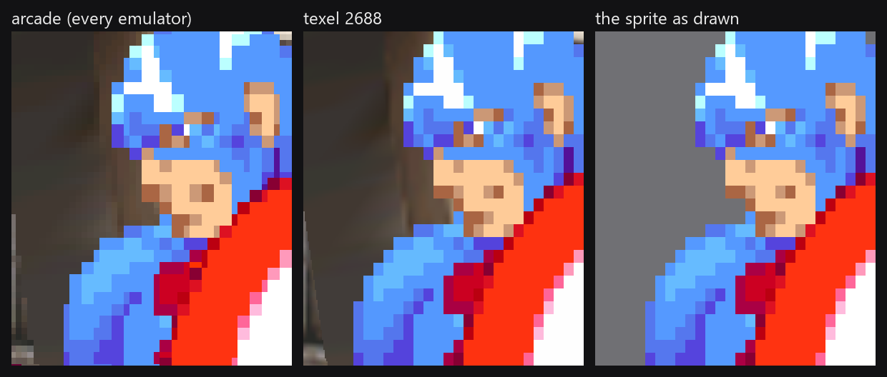
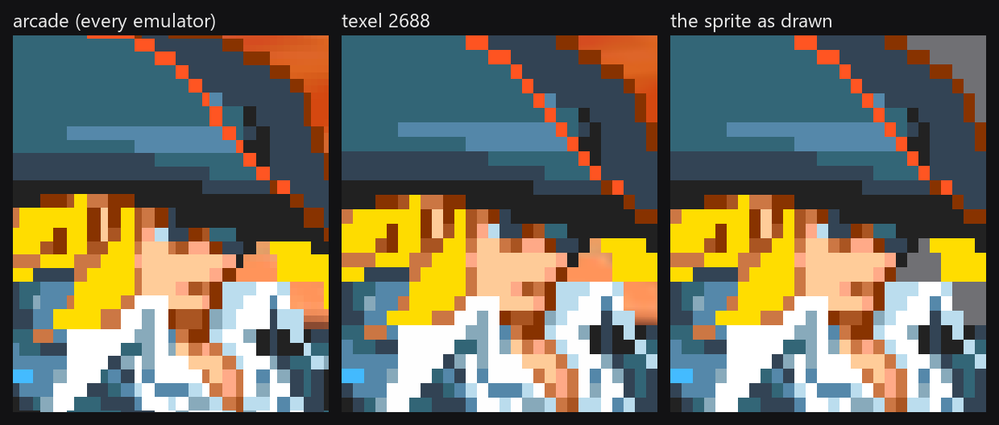
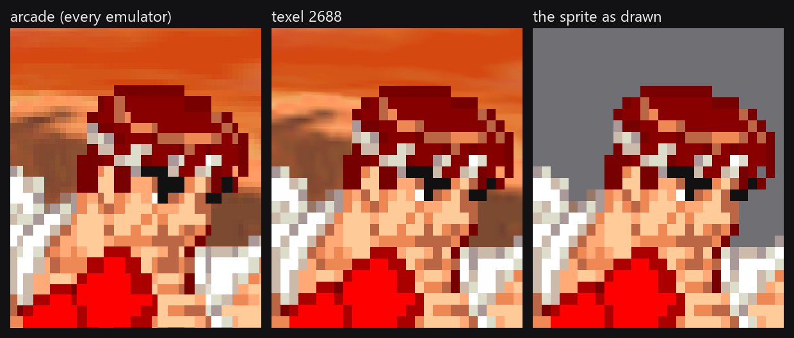
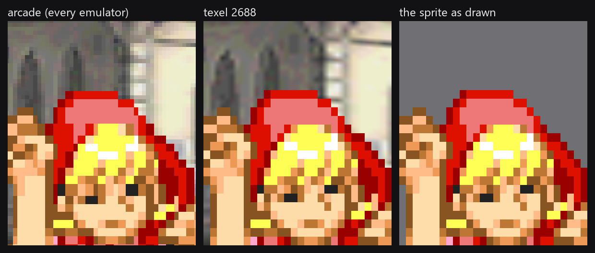
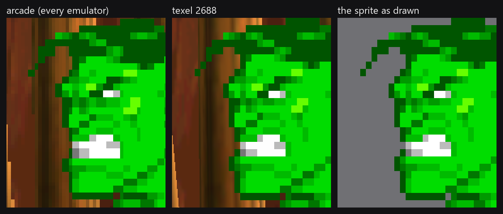
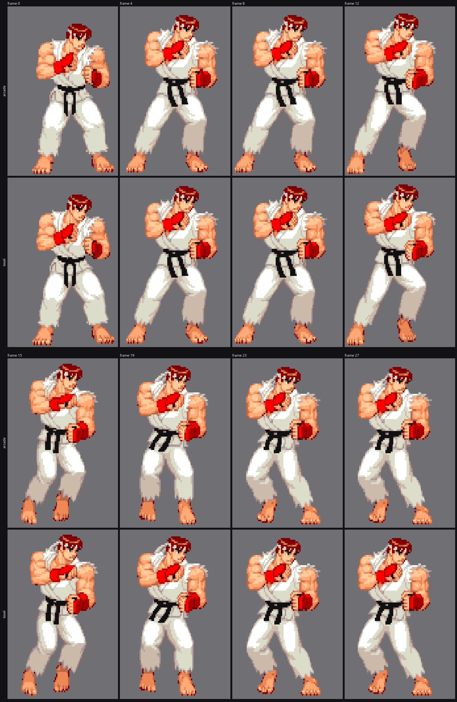
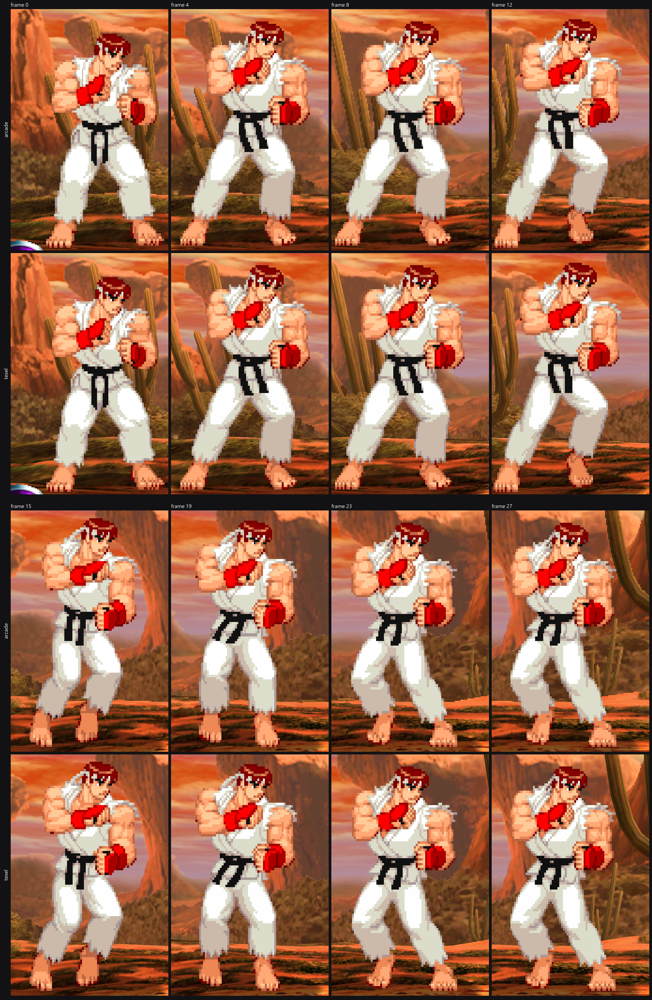
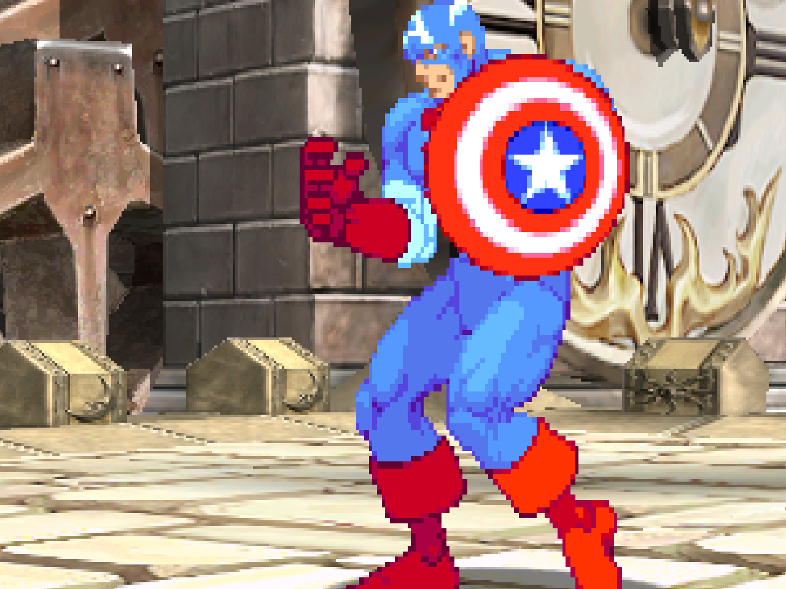
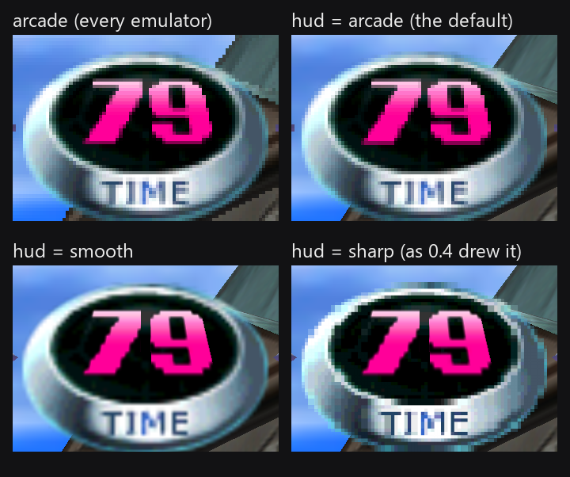

# The characters' pixels

The characters are CPS2-era art: drawn for a 384 by 224 screen, whose pixels are 7 wide to 9 tall. The arcade draws
them into its 640 by 480 frame, so each pixel of the art becomes 5/3 of the frame's pixels across and 15/7 down. A
frame's pixels are whole, so the art's columns come out 1 or 2 pixels wide and its rows 2 or 3 tall, unevenly. This is
what the arcade puts out, so every emulator shows it too.

`sprites = texel` reads the art's own pixels where they fall instead of the frame's. At `resolution = 4.2`, 2688 by
2016, each is a block 7 wide and 9 tall exactly, and the characters look as their art was drawn.

Each sheet shows one place three ways: the arcade's frame enlarged, the port at 2688 by 2016, and the sprite as drawn
(one block a pixel of the art).

## In motion

Ryu's walk, eight frames of one cycle, the arcade above and texel below: on the arcade the uneven columns and rows
move through the sprite as it moves, at 2688 by 2016 every frame keeps the art's blocks. First alone, then with the
stage.

## The whole frame

With `scale = integer` the frame is shown pixel for pixel (a 4K screen keeps black bars). At 1920 by 1440 a pixel of
the art is 5 by 6 3/7: the columns are exact and the rows meet in blended sevenths. The stages stay smooth, drawn at
the same size.

Why 2688 by 2016: the art's pixels come out whole at 4.2 times the frame (21/5), and at no smaller size. The frame's
own pixels are whole only at whole multiples, so a size exact for both, art and stage, is 21 times: 13440 by 10080.
4.2 times is exact for the characters, and it fits a 4K screen.

## The grid

A character is drawn as several sprites. `texel_grid = shared` (the default) puts every sprite's corner on one grid
of the art's pixels, counted from the screen's corner, as the art was laid out, so the parts meet as they were drawn.
A sprite then sits at most half a pixel of the art (3.5 by 4.5 pixels at 2688 by 2016) from where the game put it:
while the stage scrolls smoothly, the characters move across it in steps of one pixel of the art, as sprites did on
CPS2-era hardware. `texel_grid = object` keeps each sprite on its own grid, closer to where the game put it, but where
two meet they can be part of a pixel apart: a sliver of background, or a row 2 pixels short.

## The HUD

`hud = arcade` (the default) draws the timer, gauges, words and menus in the 640 by 480 frame's own pixels, each a
block, as the arcade shows them. `smooth` reads them as the game filters them; `sharp` reads them as sprites.

## Settings

In `mvc2.cfg`, or F1's menu (SPRITES, HUD and PICTURE):

| Key          | Values                                              | Default  |
|--------------|-----------------------------------------------------|----------|
| `sprites`    | `sharp`, `texel`, `smooth`, `pixel`, `arcade`       | `sharp`  |
| `texel_grid` | `shared`, `object` (F1: "texel, own grids")         | `shared` |
| `hud`        | `arcade`, `smooth`, `sharp`                         | `arcade` |
| `resolution` | `auto`, `1` to `12` (`4.2` for 2688 by 2016)        | `auto`   |
| `scale`      | `aspect`, `integer`, `stretch`                      | `aspect` |

All of these need `renderer = gpu`. At `resolution = 1` the picture is the arcade's.
